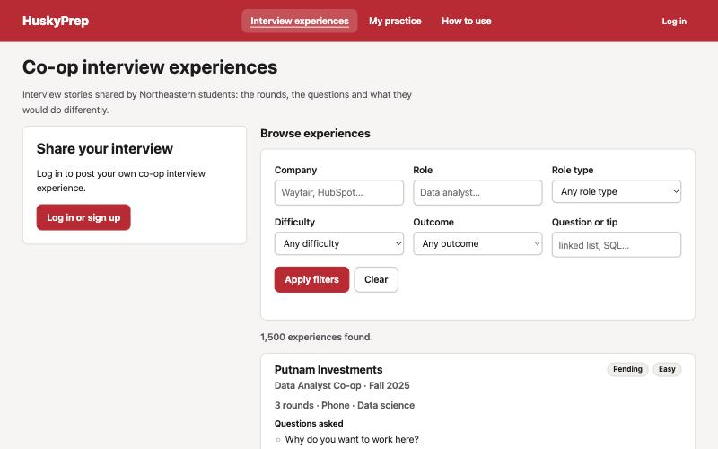
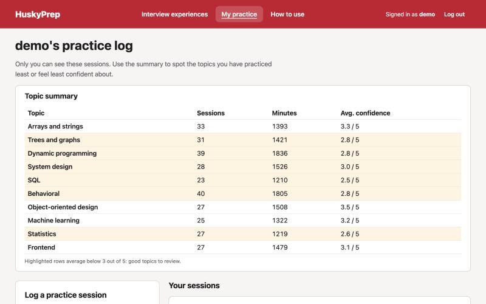

# HuskyPrep

A co-op interview experience board and personal practice tracker for
Northeastern students.





## Authors

- **Drashti Bhavsar**: Interview experiences (`interview_experiences`
  collection, routes, validation, React components) and Passport login
- **Hard Gondaliya**: Practice log (`practice_sessions` collection, routes,
  validation, React components)

## Class

[CS 5610 Web Development, Northeastern University](https://johnguerra.co/classes/webDevelopment_online_fall_2026/),
taught by Prof. John Alexis Guerra Gómez.

## Links

- Code: [github.com/Drashti0913/huskyprep](https://github.com/Drashti0913/huskyprep)
- Live app: [huskyprep.onrender.com](https://huskyprep.onrender.com)
- Demo video: [Youtube](https://youtu.be/nGKc4q1QWD0)
- Slides: [Google Slides](https://docs.google.com/presentation/d/1Y3Ol38MDR39I9MwgHsdD70JorNTz_zEl5H7wt61QMBA/edit?usp=sharing)
- Design document: [docs/DESIGN.md](docs/DESIGN.md)

## Project objective

Co-op interview advice at Northeastern is scattered across Reddit, group chats
and word of mouth, and students rarely track their own preparation. HuskyPrep
lets students:

1. **Share and browse interview experiences**: what each company asked, how
   many rounds there were, how hard it was and how it turned out.
2. **Keep a private practice log**: log each practice session with a confidence
   score and see which topics need more work.

## How to use

- **Browse** (no account needed): open _Interview experiences_, set any filters
  and select _Apply filters_.
- **Log in or sign up** with the _Log in_ button. To try it quickly, use the demo
  account: username `demo`, password `huskyprep-demo`.
- **Share an interview**: fill in _Share your interview_. List one question per
  line. Your own posts show _Edit_ and _Delete_.
- **Practice log**: open _My practice_, log a session, and use the topic summary
  and filters to find weak topics.

The _How to use_ tab in the app has the same instructions.

## Tech stack

- Frontend: React 19 with Hooks, Vite, PropTypes, plain CSS per component,
  `fetch` for AJAX
- Backend: Node.js, Express 5, ES modules
- Auth: Passport (`passport-local`), `express-session`, `connect-mongo`, `bcrypt`
- Database: MongoDB with the official `mongodb` driver (no Mongoose)
- Tooling: ESLint, Prettier

## Project structure

```
server.js                    Express app: sessions, Passport, API, serves frontend/dist
package.json                 Backend dependencies and scripts
backend/
  constants.js               Allowed values (role types, topics, ...)
  auth/passport.js           Passport local strategy and session serialization
  auth/requireAuth.js        Middleware for routes that need a login
  db/connection.js           MongoDB connector
  db/usersDB.js              users collection
  db/experiencesDB.js        interview_experiences collection
  db/sessionsDB.js           practice_sessions collection
  routes/                    One Express router per resource
  validation/                Input validation per collection
scripts/seed.js              Loads 61 users, 1,500 experiences, 1,200 sessions (synthetic)
frontend/
  package.json               Frontend dependencies and scripts
  src/components/            One React component per file, CSS file with the same name
  src/api/                   fetch wrappers for each API
docs/                        Design document, mockups, screenshots
```

## Build and run locally

Requirements: Node.js 22 or newer and a MongoDB database (local or
[MongoDB Atlas](https://www.mongodb.com/atlas)).

```bash
git clone https://github.com/Drashti0913/huskyprep.git
cd huskyprep
npm install
cp .env.example .env    # set MONGO_URI and SESSION_SECRET
npm run seed            # synthetic data, replaces existing documents
npm run build           # installs and builds the React frontend
npm start               # http://localhost:3000
```

For frontend development with hot reload, run `npm run dev` in the root and
`npm run dev --prefix frontend` in a second terminal, then open
http://localhost:5173. Vite forwards `/api` calls to Express, so no CORS setup
is needed.

| Command                | What it does                        |
| ---------------------- | ----------------------------------- |
| `npm run lint`         | ESLint for the backend and frontend |
| `npm run format`       | Format every file with Prettier     |
| `npm run format:check` | Check formatting                    |

## Deployment (Render)

1. Create a **Web Service** from this repository.
2. Build command: `npm install && npm run build`. Start command: `npm start`.
3. Environment variables: `MONGO_URI`, `DB_NAME=huskyprep`,
   `SESSION_SECRET` (a long random string) and `NODE_ENV=production`.
4. Run `npm run seed` once from your machine with `MONGO_URI` pointing at Atlas.

Credentials live only in `.env` (ignored by git) and in Render's settings.

## Use of AI

First drafts of the design document, mockups and this README. We tested the app,
deployed it, and reviewed the code so that each of us can explain the part we
own.

## License

[MIT](LICENSE)
