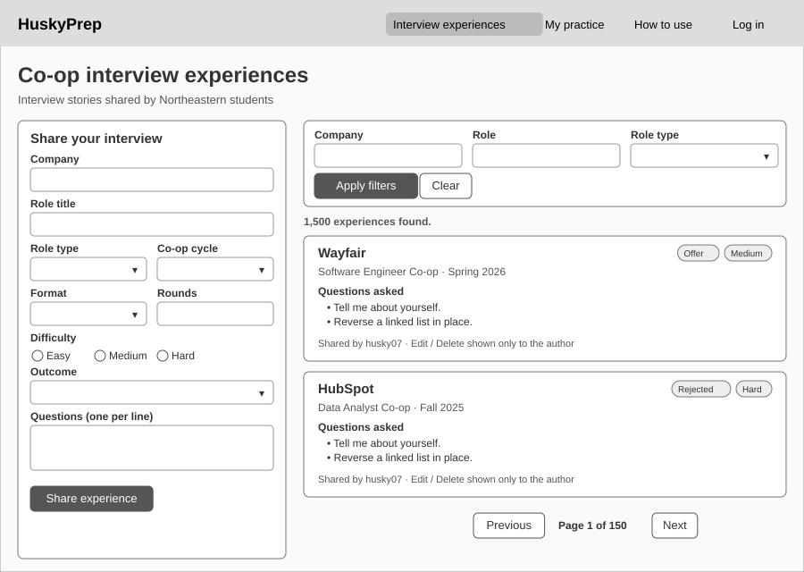
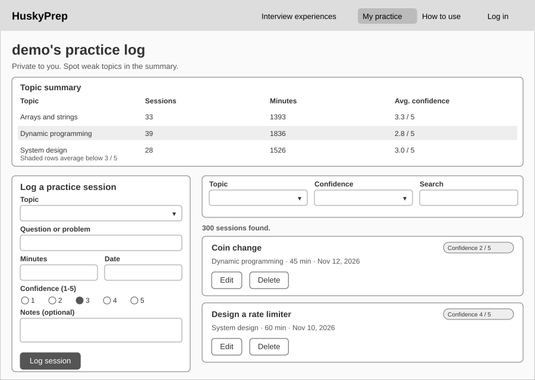
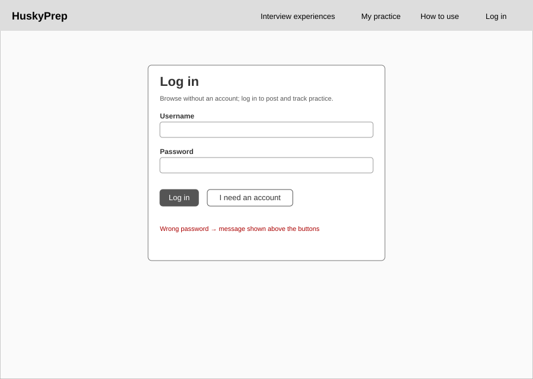

# HuskyPrep Design Document

**Team:** Drashti Bhavsar and Hard Gondaliya
**Course:** CS 5610 Web Development, Northeastern University

## 1. Project description

Co-op is a core part of a Northeastern degree, but advice about co-op
interviews is scattered across Reddit threads, group chats and word of mouth.
Students walk into interviews without knowing how many rounds to expect or what
kinds of questions a company asks, and they rarely track their own preparation
in a structured way.

HuskyPrep gives students two independent tools:

| Feature               | Collection              | Owner           | What users can do                                                                                                                       |
| --------------------- | ----------------------- | --------------- | --------------------------------------------------------------------------------------------------------------------------------------- |
| Interview experiences | `interview_experiences` | Drashti Bhavsar | Post an interview (company, role, rounds, questions, difficulty, outcome), browse and filter everyone's posts, edit or delete their own |
| Practice log          | `practice_sessions`     | Hard Gondaliya  | Log private practice sessions (topic, question, minutes, confidence), see a per-topic summary, filter, edit and delete                  |
| Accounts              | `users`                 | Drashti Bhavsar | Sign up, log in and log out with Passport (local strategy)                                                                              |

The two features use separate collections, routes and React components, so
neither depends on the other.

**Tech stack:** React with Hooks (client-side rendering, built with Vite),
PropTypes, CSS per component; Node.js and Express; Passport with
express-session and connect-mongo; MongoDB through the native Node.js driver.
No Mongoose, no axios, no CORS package and no template engines.

## 2. User personas

### Aisha Rahman: second-year CS student before her first co-op search

- **Context:** Applying to her first co-op cycle with 40 applications out.
- **Frustration:** She doesn't know what a "technical screen" at HubSpot or
  Wayfair actually involves, and upperclass friends give conflicting advice.
- **Goal:** Read what recent students were asked at the companies she applied
  to, filtered by role and difficulty.
- **Uses:** Interview experiences (browse and filter).

### Marcus Lee: fourth-year data science student back from co-op

- **Context:** Just finished three interview loops and got an offer.
- **Frustration:** He remembers how lost he felt as a first-timer and wants to
  help, but posting on Reddit feels anonymous and scattered.
- **Goal:** Share each loop once, accurately, and update it if he remembers
  more questions.
- **Uses:** Interview experiences (create, edit, delete) and accounts.

### Priya Nair: third-year student practicing on a schedule

- **Context:** Practices LeetCode and behavioral questions 4-5 times a week.
- **Frustration:** She can't tell which topics she has neglected, so she keeps
  redoing arrays problems she already knows.
- **Goal:** Log every session with a confidence score and see her weak topics
  at a glance.
- **Uses:** Practice log (create, read, update, delete) and accounts.

## 3. User stories

### Interview experiences (Drashti Bhavsar)

1. **Post an experience.** _As a student, I want to post my co-op interview
   experience (company, role, rounds, questions asked, difficulty, outcome) so
   others know what to expect._
   Marcus logs in, fills in the "Share your interview" form for his Fidelity
   data analyst loop (3 rounds, virtual, medium, offer) and lists the four
   questions he was asked, one per line. His post appears at the top of the
   list.

2. **Browse and filter.** _As a student, I want to browse and filter experiences
   by company, role, difficulty and outcome so I can prepare for a specific
   interview._
   Aisha has a Wayfair software interview next week. Without logging in, she
   types "Wayfair" in the company filter and chooses role type "Software
   engineering". She reads the questions in each matching post.

3. **Edit or delete my post.** _As the author of an experience, I want to edit or
   delete it so the information stays accurate._
   Marcus remembers a fifth question, selects **Edit** on his post and adds it.
   Later he realizes he posted one loop twice and deletes the duplicate after
   confirming. Other users never see Edit or Delete on his posts, and the
   server rejects edits from anyone but the author.

4. **Accounts.** _As a student, I want to sign up, log in and log out so that only
   I can edit my own posts._
   Aisha creates an account with a username and password. Passwords are hashed
   with bcrypt and the session is stored in MongoDB.

### Practice log (Hard Gondaliya)

1. **Log a session.** _As a student, I want to log a practice session (topic,
   question, time spent, confidence 1-5, notes) so I can track my preparation._
   After 45 minutes on "Coin change", Priya logs it under Dynamic programming
   with confidence 2.

2. **View and filter.** _As a student, I want to view and filter my sessions by
   topic and confidence so I know what to review._
   The topic summary shows Dynamic programming averaging 2.8/5, highlighted as
   weak. Priya filters to Dynamic programming with confidence 2 and sees exactly
   which problems to redo.

3. **Update a session.** _As a student, I want to edit a session after practicing
   again so my confidence level stays current._
   A week later she solves Coin change on her own, edits the session and raises
   her confidence to 4.

4. **Delete a session.** _As a student, I want to delete sessions I no longer
   need._
   She deletes a session she logged by mistake.

## 4. Design mockups

Low-fidelity wireframes made before building the components.

### Interview experiences

### My practice

### Log in

## 5. React components

Each component lives in its own `.jsx` file with a `.css` file of the same name
(when it needs styling) and defines PropTypes.

| Component           | File                                  | Hooks used                                       |
| ------------------- | ------------------------------------- | ------------------------------------------------ |
| `App`               | `components/App.jsx`                  | `useState`, `useEffect`, `useCallback`, `useRef` |
| `NavBar`            | `components/common/NavBar.jsx`        |                                                  |
| `AuthForm`          | `components/common/AuthForm.jsx`      | `useState`                                       |
| `HowToUse`          | `components/common/HowToUse.jsx`      |                                                  |
| `Notice`            | `components/common/Notice.jsx`        |                                                  |
| `Pagination`        | `components/common/Pagination.jsx`    |                                                  |
| `ConfirmDialog`     | `components/common/ConfirmDialog.jsx` | `useRef`, `useEffect`                            |
| `ExperiencesPage`   | `components/experiences/`             | `useState`, `useEffect`                          |
| `ExperienceFilters` | `components/experiences/`             | `useState`                                       |
| `ExperienceForm`    | `components/experiences/`             | `useState`                                       |
| `ExperienceCard`    | `components/experiences/`             |                                                  |
| `PracticePage`      | `components/practice/`                | `useState`, `useEffect`                          |
| `TopicSummary`      | `components/practice/`                |                                                  |
| `SessionFilters`    | `components/practice/`                | `useState`                                       |
| `SessionForm`       | `components/practice/`                | `useState`                                       |
| `SessionCard`       | `components/practice/`                |                                                  |

## 6. Data model

### `users`

| Field          | Type   | Notes                         |
| -------------- | ------ | ----------------------------- |
| `username`     | string | Unique, lowercase, 3-30 chars |
| `passwordHash` | string | bcrypt hash, never sent out   |
| `createdAt`    | date   |                               |

### `interview_experiences`

| Field                    | Type             | Notes                                           |
| ------------------------ | ---------------- | ----------------------------------------------- |
| `company`, `role`        | string           | Free text                                       |
| `roleType`               | string           | software engineering, data science, ...         |
| `coopCycle`              | string           | e.g. "Spring 2026"                              |
| `format`                 | string           | virtual, in person, phone                       |
| `rounds`                 | number           | 1-10                                            |
| `difficulty`             | string           | easy, medium, hard                              |
| `outcome`                | string           | offer, rejected, no response, withdrew, pending |
| `questions`              | string[]         | 1-15 questions                                  |
| `tips`                   | string           | Optional                                        |
| `authorId`, `authorName` | ObjectId, string | Set by the server from the session              |
| `createdAt`, `updatedAt` | date             |                                                 |

### `practice_sessions`

| Field                    | Type     | Notes                                       |
| ------------------------ | -------- | ------------------------------------------- |
| `userId`                 | ObjectId | Owner; every query is scoped to it          |
| `topic`                  | string   | arrays and strings, system design, SQL, ... |
| `question`               | string   |                                             |
| `minutes`                | number   | 1-600                                       |
| `confidence`             | number   | 1-5                                         |
| `practicedOn`            | string   | `YYYY-MM-DD`                                |
| `notes`                  | string   | Optional                                    |
| `createdAt`, `updatedAt` | date     |                                             |

## 7. API

| Method | Route                  | Auth   | Purpose                                   |
| ------ | ---------------------- | ------ | ----------------------------------------- |
| GET    | `/api/auth/me`         |        | Current user or `null`                    |
| POST   | `/api/auth/signup`     |        | Create an account and log in              |
| POST   | `/api/auth/login`      |        | Log in (Passport local strategy)          |
| POST   | `/api/auth/logout`     |        | Log out                                   |
| GET    | `/api/meta`            |        | Allowed values for dropdowns              |
| GET    | `/api/experiences`     |        | List and filter experiences (paginated)   |
| POST   | `/api/experiences`     | Yes    | Create an experience                      |
| PUT    | `/api/experiences/:id` | Author | Update own experience                     |
| DELETE | `/api/experiences/:id` | Author | Delete own experience                     |
| GET    | `/api/sessions`        | Yes    | List own sessions, plus per-topic summary |
| POST   | `/api/sessions`        | Yes    | Create a session                          |
| PUT    | `/api/sessions/:id`    | Owner  | Update own session                        |
| DELETE | `/api/sessions/:id`    | Owner  | Delete own session                        |
